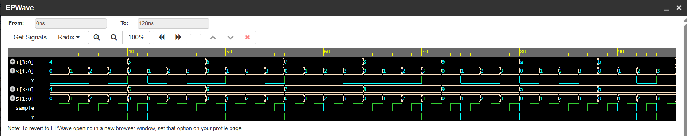

# 4:1 Multiplexer – Design and Functional Verification Using a Layered SystemVerilog Testbench

## 1. Project Overview

This project focuses on the design and functional verification of a 4:1 Multiplexer (MUX) using SystemVerilog.

The design is implemented using RTL coding, and its functionality is verified using a modular, class-based layered testbench.

The simulation is performed using **EDA Playground with Siemens Questa 2025.2**, and the output waveforms are analysed using EPWave.

## 2. Objectives

- Design a 4:1 Multiplexer using SystemVerilog.
- Understand the working principle of a multiplexer.
- Develop a layered SystemVerilog testbench.
- Implement Generator, Driver, Monitor, Scoreboard, Environment and Test components.
- Verify all possible input combinations.
- Analyse simulation results using EPWave.

## 3. About the 4:1 Multiplexer

A 4:1 Multiplexer is a combinational circuit that selects one of four data inputs and forwards it to a single output based on two select lines.

**Inputs:**
- Four data inputs: I[3:0]
- Two select lines: S[1:0]

**Output:**
- One output: Y

### Truth Table

| S1 | S0 | Output |

| 0  | 0  | I0     |

| 0  | 1  | I1     |

| 1  | 0  | I2     |

| 1  | 1  | I3     |


### Boolean Expression

Y = S1'S0'I0 + S1'S0I1 + S1S0'I2 + S1S0I3

## 4. Layered Testbench Architecture

The testbench follows a modular verification architecture consisting of the following components:

| Component      | Function                                         |
| Interface      | Connects the testbench signals to the DUT        |
| Transaction    | Stores input, select and output values           |
| Generator      | Generates test transactions                      |
| Driver         | Applies transactions to the DUT                  |
| Monitor        | Observes and captures DUT signals                |
| Scoreboard     | Compares actual and expected outputs             |
| Environment    | Instantiates and connects verification components|
| Test           | Starts and controls the verification process     |

### Verification Flow

Generator → Driver → DUT → Monitor → Scoreboard

Mailboxes are used for communication between the Generator and Driver, and between the Monitor and Scoreboard.

## 5. Repository Structure

```text
4-to-1-MUX-Layered-Testbench/
│
├── design.sv
├── testbench.sv
├── mux_waveform.png
└── README.md
```

### File Description

- `design.sv` – SystemVerilog RTL implementation of the 4:1 MUX.
- `testbench.sv` – Complete layered testbench implementation.
- `mux_waveform.png` – Simulation waveform captured using EPWave.
- `README.md` – Project documentation.

## 6. Simulation Environment

| Parameter                    | Configuration         |
| HDL                          | SystemVerilog         |
| Platform                     | EDA Playground        |
| Simulator                    | Siemens Questa 2025.2 |
| Waveform Viewer              | EPWave                |
| Design File                  | design.sv             |
| Testbench File               | testbench.sv          |
| Top-Level Testbench Module   | tb                    |

## 7. Verification Methodology

The Generator uses two nested loops to generate all possible combinations of the four data inputs and two select lines.

- Number of data input combinations = 2⁴ = 16
- Number of select combinations = 2² = 4
- Total test cases = 16 × 4 = 64

The Driver applies the generated transactions to the DUT.

The Monitor captures the input signals, select lines and actual output.

The Scoreboard calculates the expected output using:

```systemverilog
expected = tr.I[tr.S];
```

The actual output is compared with the expected output to determine whether each test case passes or fails.

## 8. Simulation Results

All 64 possible input combinations were successfully tested.

| Parameter               | Result     |

| Total Test Cases        | 64         |

| Passed                  | 64         |

| Failed                  | 0          |

| Functional Verification | Successful |


The simulation completed without compilation errors.

## 9. Simulation Waveform

The following waveform was captured using EPWave.



The waveform demonstrates the variation of the data inputs, select lines, output and sampling signal during simulation.

The output follows the selected data input according to the select-line combination.

## 10. Conclusion

The 4:1 Multiplexer was successfully designed and functionally verified using SystemVerilog and a layered testbench.

All 64 possible input combinations were tested, and all test cases passed successfully.

The experiment demonstrates the use of modular verification components and automated output checking in digital design verification.

## 11. Tools and References

- [EDA Playground](https://www.edaplayground.com/)
- [SystemVerilog Language Reference](https://standards.ieee.org/)
- Siemens Questa Simulator
- EPWave

## 12. Project Repository

[GitHub Repository – 4:1 MUX Layered Testbench](https://github.com/chit-06/4-to-1-MUX-Layered-Testbench)
